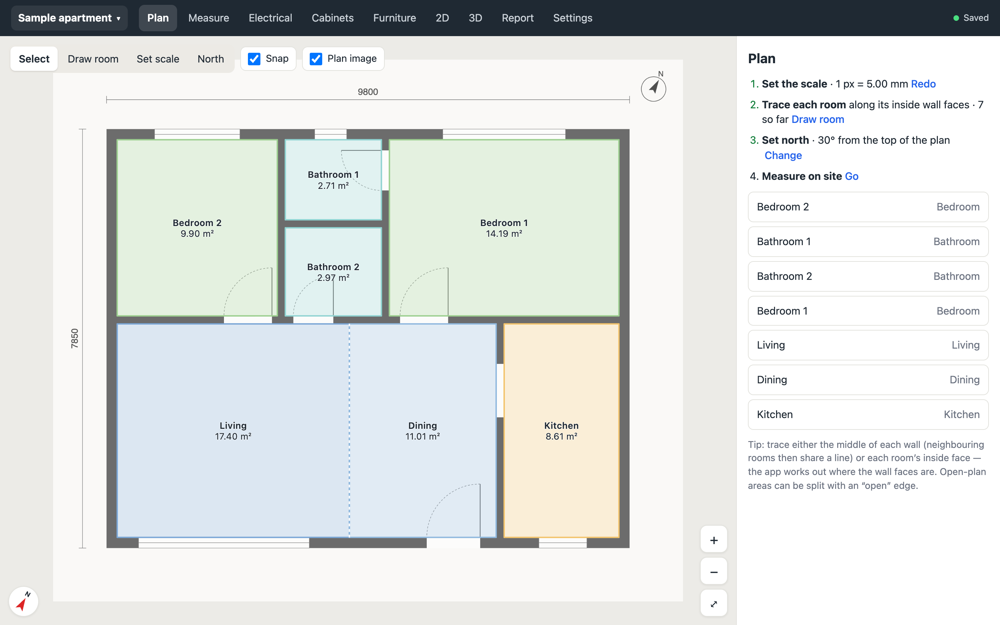
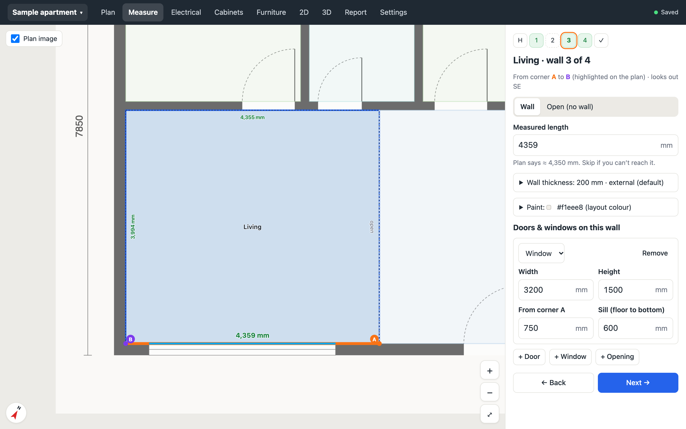
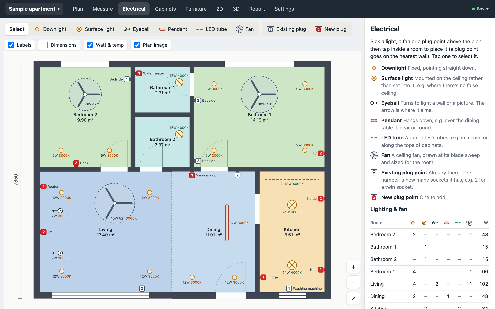
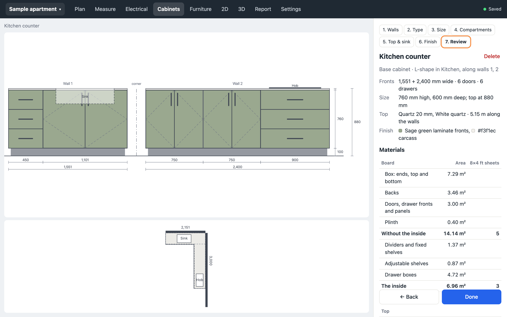
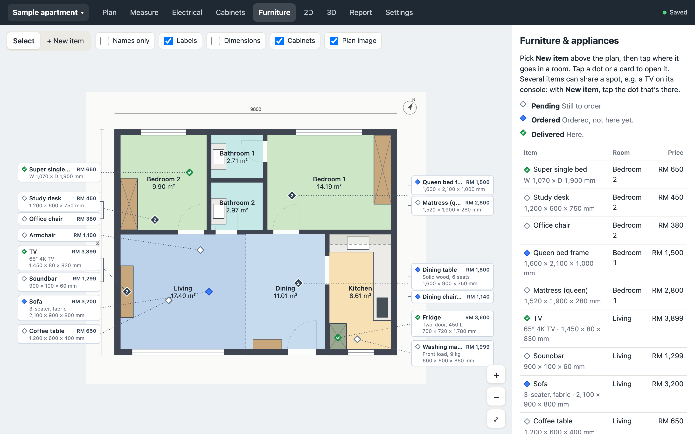
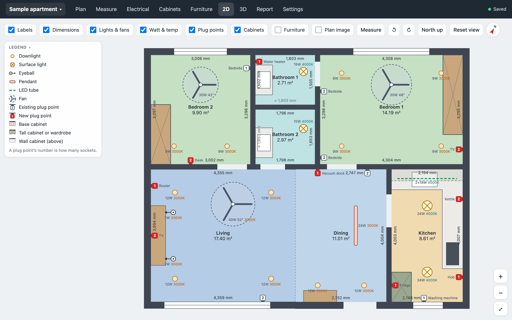
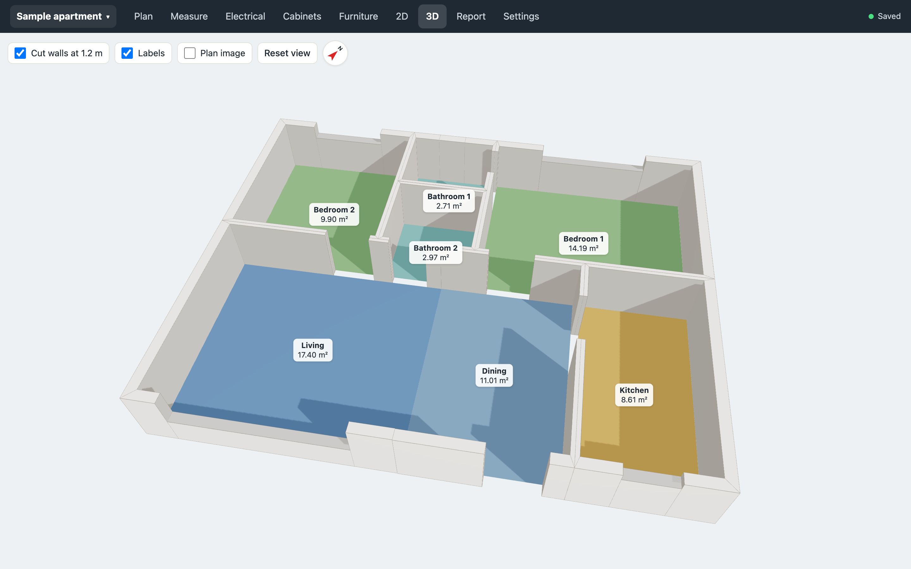
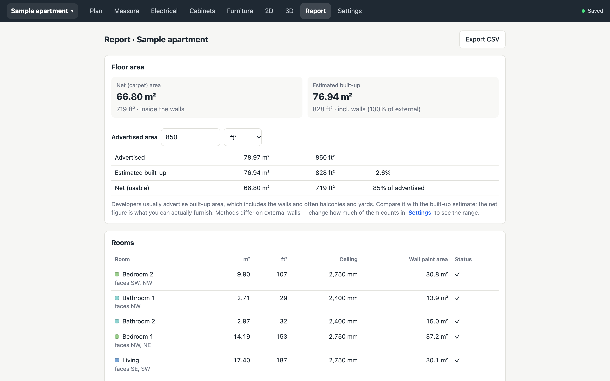

# Apartment Measure

Check an apartment's real floor area against the advertised figure, and size the aircon for each space. You start from a 2D floor plan image, and the app walks you through measuring every wall on site.

## Features

- **Floor area**: trace each room on the plan, measure it on site, and compare the net and built-up area with the advertised figure.
- **Guided measuring**: go wall by wall on your phone. A reading far off the plan is flagged, a wall you can't reach is worked out from the others, and a plan that isn't quite to scale can be rescaled to your measurements.
- **Aircon sizing**: an estimate for each room or open-plan zone, allowing for the ceiling height and afternoon sun, and a check of any units already installed.
- **Which way rooms face**: set north from the plan's arrow, and each room's outside walls get a compass direction.
- **Electrical**: place lights, ceiling fans and plug points, with their power, colour temperature and model, and a schedule room by room.
- **Cabinets**: plan built-in kitchen cabinets, wardrobes and vanities wall by wall (straight, L or U), with compartments, stone tops, sink and hob cut-outs, things to check, and a materials list.
- **Furniture**: place loose furniture and appliances, with their sizes and prices, and track whether each is still to order, ordered or delivered.
- **2D and 3D**: a floor plan drawn from your measurements, with every layer and a tool to measure between any two points, and a 3D model to orbit.
- **Report**: all of it on one page, with a CSV export.
- **On site and on two devices**: edits are kept on the phone when there's no signal and sent once it reconnects, and a phone and a laptop can work on the same layout. A layout exports to a single file.

[docs/workflow.md](docs/workflow.md) goes through each tab step by step.

## Screenshots

These show a made-up two-bedroom apartment.

<table>
<tr>
<td width="50%"><br><b>Plan</b>: trace the rooms over the floor plan image.</td>
<td width="50%"><br><b>Measure</b>: measure each wall on site, with the plan's estimate beside it.</td>
</tr>
<tr>
<td width="50%"><br><b>Electrical</b>: lights, ceiling fans and plug points, with a schedule room by room.</td>
<td width="50%"><br><b>Cabinets</b>: a kitchen counter from the front and from above, with its materials.</td>
</tr>
<tr>
<td width="50%"><br><b>Furniture</b>: furniture and appliances, with their prices and whether each is ordered or delivered.</td>
<td width="50%"><br><b>2D</b>: the floor plan drawn from the measurements, with every layer and a legend.</td>
</tr>
<tr>
<td width="50%"><br><b>3D</b>: the model, with the walls cut at 1.2 m.</td>
<td width="50%"><br><b>Report</b>: the floor area against the advertised figure, and the rest of the report.</td>
</tr>
</table>

## Run it

1. Install [Node.js](https://nodejs.org/en/download) 22.18 or newer (npm comes with it). The server runs its TypeScript directly and uses Node's built-in SQLite, which older versions don't have.
2. Then, in the project folder:

```sh
npm install
npm run dev        # API on :8787 + web app on http://localhost:5173
npm test           # geometry + API tests
npm run build      # type-check and build the web app into dist/
npm start          # production: one process serves dist/ and the API on :8787
```

To try it from your phone on the same Wi-Fi, run `npm run build && npm start`, then open `http://<your-computer's-IP>:8787` on the phone.

To try it without a plan of your own, create a layout and pick **Use the sample plan** on the Plan tab.

### Configuration (environment variables)

| Variable      | Default                      | Purpose                                               |
| ------------- | ---------------------------- | ----------------------------------------------------- |
| `PORT`        | `8787`                       | HTTP port                                             |
| `DB_PATH`     | `data/apartment-measure.db`  | SQLite database file                                  |
| `UPLOADS_DIR` | `data/uploads`               | Plan images, one folder per layout                    |
| `ACCESS_KEY`  | *(unset)*                    | If set, the app asks for this key once on each device |

Set `ACCESS_KEY` whenever the server can be reached from the internet.

## Storage

- **SQLite** (`data/apartment-measure.db`, built into Node, so nothing to install):
  - `layouts`: one row per layout. The rooms, measurements and settings are stored as a JSON document, with a `revision` number.
  - `layout_images`: records which image file belongs to each layout.
  - Schema changes are versioned in `server/db.ts` (`MIGRATIONS`, tracked with `PRAGMA user_version`).
- **Plan images** are plain files on disk: `data/uploads/<layout-id>/plan-<n>.jpg`. To back everything up, copy the `data/` folder.
- **Saving** happens automatically, a moment after each edit. Every edit is also kept in the browser until the server confirms it. If the phone loses signal on site, the header shows "Offline · kept on this device" and the edits are sent once it reconnects.
- **Two devices** (e.g. phone and laptop): if one saves a newer version, the other gets a banner offering "Load the other version" or "Keep mine" instead of silently overwriting. Each save carries the revision it was based on; the server rejects the save if a newer one exists.
- **Export / import**: Settings → Export layout produces a single file with the image embedded, and Layouts → Import from file loads one.

## How the numbers are worked out

- **Room closure.** Wall directions come from the traced plan and lengths come from your tape. Real measurements never close a room perfectly, so lengths are adjusted by weighted least squares until the outline closes exactly (`src/geometry/closure.ts`). The size of the adjustment taken up by measured walls is the room's *closure error*. A room is flagged when that error exceeds the tolerance (25 mm by default). Unmeasured walls are loose priors, so a skipped wall absorbs the error in its own direction.
- **Rescaling.** Each measured wall gives a scale: its length plus the wall thickness between the traced line and the inside face, divided by its traced length in pixels. Walls more than 8% (or 150 mm) off the median are left out, as a typo or a spot where the plan is wrong. The rest are fitted by least squares, so long walls count most (`src/geometry/scale.ts`). Rescaling only changes the real length of the dimension you set the scale with. Your measurements stay as they are.
- **Placement.** Each room is shifted, again by least squares, so that faces on either side of a shared wall end up exactly one *measured* wall thickness apart (`src/geometry/layout.ts`). Shared and external walls are detected from the plan. Walls of different rooms that continue one straight line on the plan (an outside wall running past the living and dining rooms, say) are kept flush, so when measurements and the plan disagree, the difference goes into the thickness of internal walls, not into a step in a straight wall.
- **Areas.**
  - *Net* is the sum of the room interiors, less the floor that pillars stand on. Aircon and fan sizes go by this area too.
  - *Built-up* is the union of all rooms, each grown by the wall thickness it owns: half of an internal wall, and all of an external wall. Pillars count in it, as walls do. **Settings** lets you count external walls at 100%, 50% or 0%, because developers measure this differently.
  - *Wall paint area* is the length of the room's wall faces times its ceiling height, less doors and windows. A pillar hides the wall behind it and adds its own faces, so one in the middle of a wall adds its two sides, and one in a corner changes nothing.
- **Facing.** Once north is set, a room faces the directions of its outside walls, walls onto a balcony, and open sides with nothing beyond (`src/geometry/facing.ts`). The plan can't tell open air from the next unit or a corridor, so in the **North** tool the outside walls are coloured by direction. Tap any that are really against the next unit, a lobby or a corridor to rule them out (also on each wall's Measure step).
- **Aircon.** Area (ft²) × 60 BTU/h × (ceiling height ÷ 2.7 m), plus 10% for rooms with afternoon sun. A room gets the sun margin automatically when it faces SW, W or NW; you can override it per room in Measure. The result is rounded up to a standard 1.0, 1.5, 2.0 or 2.5 HP unit. If a room already has a unit (set **Aircon already installed** on the Plan tab or the room's Measure step), the report checks it instead: green if it covers the estimate, allowing the estimate to be up to 10% above its rating (adjustable in Settings), red if it may be too small. The units in all rooms of an aircon zone add up. This is a Malaysian rule of thumb: use it for budgeting, and confirm with the installer.

- **Cabinet materials.** Approximate, for planning and comparing quotes. Each straight run is taken as one box: two ends, a top and bottom, and a back, with an upright divider (or fixed shelf) between each pair of compartments; at a corner, the leg before it runs into the corner. Board is counted by area, with nothing added for offcuts, split into **without the inside** (the box, backs, fronts and plinth) and **the inside** (dividers, adjustable shelves and drawer boxes), with the number of 8 × 4 ft sheets each would take by area. The top is its area seen from above (cut-outs included), its length along the walls, its exposed front edge and its upstand. A fixed panel beside a door counts as front board, with no hinges or handle. Fittings: doors (a pair is two), hinges (2 for a door up to 900 mm high, 3 up to 1,600, 4 up to 2,000), lift-up stays, drawers (a pair of runners each), handles, shelves, hanging rails and plinth length.

## Known limits / next ideas

- Wall angles come from the plan, so a room that is out of square isn't detected. Measuring the diagonals would fix this.
- Rescaling uses one scale for the whole plan, so a plan stretched more one way than the other is only half corrected.
- Room tracing is manual. A vision model could draft the rooms for you to correct.
- Plans in PDF format need converting to an image first.
- Laser measure over Bluetooth (Bosch/Leica) works on Android Chrome only.
- Only one user; there are no accounts.
- On a phone held upright, the furniture cards beside the plan leave it narrow; zoom in, turn the phone, or untick **Furniture** on the 2D tab. Cards above and below the plan would suit a tall, narrow screen better.
- Cabinets aren't drawn on the 3D tab yet, and a finish is a colour only (no pattern image yet). Sliding doors are planned compartment by compartment, though in a real wardrobe they often span several.

## License

[MIT](LICENSE)
